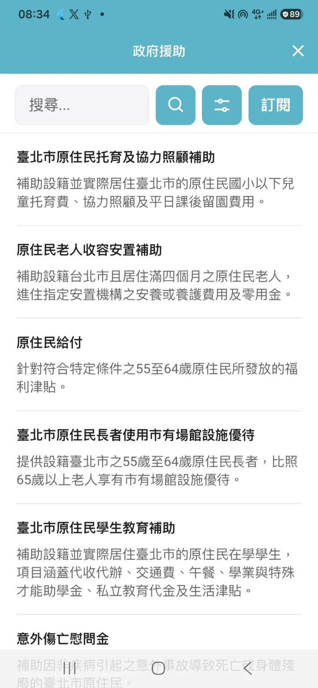

# 原民補助拿得到

在 TownPass WebView 使用的臺北市政府原住民族補助清單應用程式。



## 服務內容簡介

訪談原住民身份的朋友後，得知北市原民會的補助資訊主要係透過學校提供，畢業後難以持續獲得資訊。受限於目前沒有資料集整理補助資訊，我們以LLM爬取既有局處公告來模擬資料集。為驗證拓展性，我們也將青年局的補助資訊納入，增加資料量的同時亦可看見政府如何回應青年與原民身份的交織性。設有訂閱功能，可透過台北通推播持續接收最新補助資訊。另外亦有帶入台北通生日與原民身份等個資的功能，讓既有用戶可以快速上手使用。

清單資料事先整理好，放在 `data/indigenous.json` 與 `data/youth.json`。開啟網頁時不會再呼叫模型。如果未來有資料集可以使用，能更加簡單的整合資訊。

## 系統要求
1. Node.js 22
2. Cloudflare Workers + KV

## 如何開啟微服務 `web`
輸入指令來下載所需套件並開啟伺服器
```sh
npm install
npm run dev
```

## 如何開啟TownPass `TownPass`
輸入指令來下載所需套件並開啟伺服器
```sh
flutter pub get
dart run build_runner build
flutter run
```


## AI 使用模型（事前的資料清洗，裝置實際使用時不會呼叫）

資料整理一開始使用 OpenRouter 上的 `google/gemma-4-26b-a4b-it`（見 `src/extract.ts` 的 `MODEL_ID`），但後續使用codex直接進行資料清洗與整理。

`npm run parse` 會抓取原民會與青年局網頁，抽出補助名稱、對象、年齡、設籍與申請方式，再依摘要分類、貼上標籤。只重做分類可執行 `npm run classify`。


## License

本專案的程式以 [GNU Affero General Public License v3.0 only](LICENSE)（SPDX: `AGPL-3.0-only`）授權。再散布時須附上同一授權，並提供對應原始碼；透過網路提供這個服務時，也要讓使用者取得對應原始碼。原始碼即這個 GitHub 儲存庫。

第三方套件、字型與資料來源的說明見 [THIRD-PARTY-NOTICES.md](THIRD-PARTY-NOTICES.md)。
